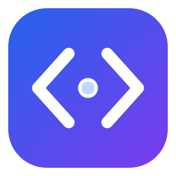
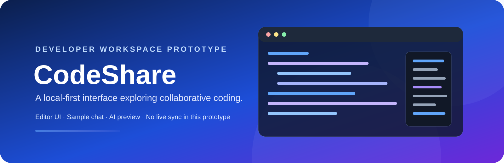

# 💻 CodeShare

**CodeShare** is a Next.js prototype exploring the interface of a collaborative coding workspace. It currently provides a landing page and a local editor/chat UI.

  

  

  
  
  
  
  
  
  
  
  
  
  
  

> **Important:** This is a UI prototype, not a live collaborative coding service. The editor and chat store state in the current browser page. Presence is represented by sample profiles, the AI preview returns a canned reply, and this repository contains no authentication, collaboration server, application API, database, model provider, or persistence layer.

## 📑 Contents

- [✨ Current features](#-current-features)
- [⚠️ Implemented behavior versus mock UI](#️-implemented-behavior-versus-mock-ui)
- [🚀 Getting started](#-getting-started)
- [🧭 Routes](#-routes)
- [🗂️ Project structure](#️-project-structure)
- [🧪 Quality checks](#-quality-checks)
- [🔐 Security and privacy](#-security-and-privacy)
- [🧱 Roadmap](#-roadmap)
- [📚 Documentation](#-documentation)
- [🤝 Contributing](#-contributing)
- [📄 License](#-license)

## ✨ Current features

- Next.js App Router landing page and directly addressable editor route.
- Editable sample code using a browser contentEditable element.
- Local language selector, theme toggle, and chat panel state.
- Team chat UI with messages held in React state.
- AI Preview tab with a fixed demonstration response.
- Static sample user avatars and presence display.
- Mantine components, Tailwind utilities, and Lucide icons.
- Project documentation, Node-native contract tests, repository validation, and GitHub Actions quality/security workflows.

## ⚠️ Implemented behavior versus mock UI

| Capability | Current reality |
|---|---|
| Landing page | Implemented UI |
| Editor | Local contentEditable text area, not Monaco or CodeMirror |
| Language selector | Local selection state only |
| Real-time code synchronization | **Not implemented** |
| Team chat across browsers | **Not implemented**, messages stay local |
| AI code assistant | **Not implemented**, response is canned |
| Online presence | **Not implemented**, profiles are hard-coded |
| Authentication and private rooms | **Not implemented** |
| Database and saved documents | **Not implemented** |
| Voice chat | Conceptual UI/copy only |
| Socket.IO | Unreferenced experiment in pagebackup.tsx; no matching server exists |

Do not use this prototype to share confidential source code or private team messages under the assumption that collaboration rooms or accounts are protected.

## 🚀 Getting started

### Requirements

- Node.js 20.9.0 or newer. Node 22 is pinned in .nvmrc and used by CI.
- npm 10 or newer is recommended.
- Git and a modern browser.

### Install and run

    git clone https://github.com/Brajesh31/CodeShare.git
    cd CodeShare
    nvm use
    npm ci
    npm run dev

Open http://localhost:3000. Visit / for the landing page and /editor for the local workspace.

### Production build

    npm run build
    npm start

## 🧭 Routes

| Route | Source | Description |
|---|---|---|
| / | app/page.tsx | Landing page and prototype disclosure |
| /editor | app/editor/page.tsx | Local editor, team/AI preview UI, theme, and sample presence |

There are no app/api routes or supported WebSocket endpoints.

## 🗂️ Project structure

The repository contains application source, governance files, CI/security workflows, scripts, tests, diagrams, runbooks, and engineering templates.

See [docs/project-structure.md](docs/project-structure.md) for the complete tracked-file tree and file-by-file responsibilities. Regenerate it after path changes with `npm run docs:tree`. See [docs/README.md](docs/README.md) for the complete documentation index.

## 🧪 Quality checks

Run the complete local check sequence:

    npm ci
    npm test
    npm run typecheck
    npm run docs:tree:check
    npm run validate
    npm run audit:security
    npm run build

GitHub Actions runs the quality workflow on pushes, pull requests, and a weekly schedule. It installs the lockfile, reports npm advisories, runs contract tests, type checks, verifies the generated project tree, validates repository links, builds the application, parses GitHub YAML/CFF metadata, and checks Mermaid/SVG assets.

Separate workflows run CodeQL analysis for JavaScript/TypeScript and dependency review for pull requests. These checks do not replace manual browser testing, accessibility evaluation, or human dependency review.

## 🔐 Security and privacy

The current app has no server-side trust boundary for editor or chat content. Do not enter confidential code, credentials, or private team discussions. Never place private keys in browser code or NEXT_PUBLIC_ variables.

The dependency audit has reported 8 advisories, including a critical Next.js finding. The repository still pins Next.js 15.3.1; npm identified 15.5.29 as the remediation candidate, but the update has not yet been applied to the lockfile. Do not deploy the current dependency tree to production. See [dependency security and remediation](docs/dependency-security.md) for the required upgrade and verification sequence.

Read [SECURITY.md](SECURITY.md), [PRIVACY.md](PRIVACY.md), [threat model](docs/threat-model.md), and [secret management](docs/secret-management.md) before proposing networked features.

## 🧱 Roadmap

1. Decide whether the project remains a front-end prototype or becomes a full product.
2. Resolve the dependency security backlog.
3. If moving to a connected product, design identity, server-authorized rooms, document synchronization, and persistence.
4. Evaluate a maintained code editor engine and its accessibility model.
5. Add a server-side AI provider proxy only with explicit privacy and consent controls.
6. Add browser integration tests, authorization tests, and a complete accessibility review.

See [ROADMAP.md](ROADMAP.md). This is a proposed direction, not a delivery promise.

## 🎨 Visual assets

The logo, banner, and architecture diagram are original static SVG assets. They are not screenshots of the running application. No product screenshots are included because a verified browser capture has not been produced.

## 📚 Documentation

Start at [docs/README.md](docs/README.md). The handbook covers product requirements, architecture, development, UX, privacy, security, QA, deployment, operations, runbooks, diagrams, and reusable engineering templates. See [docs/project-structure.md](docs/project-structure.md) for the generated tracked-file tree and [docs/test-coverage.md](docs/test-coverage.md) for the automated/manual coverage boundary.

Useful entry points:
- [Getting started](docs/getting-started.md)
- [Developer guide](docs/developer-guide.md)
- [Architecture](docs/architecture.md)
- [Project structure](docs/project-structure.md)
- [Testing strategy](docs/test-strategy.md)
- [Threat model](docs/threat-model.md)
- [Risk register](docs/risk-register.md)
- [Known issues](docs/known-issues.md)

## 🤝 Contributing

Read [CONTRIBUTING.md](CONTRIBUTING.md), [GOVERNANCE.md](GOVERNANCE.md), and [CODE_OF_CONDUCT.md](CODE_OF_CONDUCT.md). Use the issue forms and pull request template. Report security concerns privately according to [SECURITY.md](SECURITY.md).

## 👤 Authors

See [AUTHORS.md](AUTHORS.md). The repository is maintained by Brajesh Kumar ([GitHub @Brajesh31](https://github.com/Brajesh31)).

## 📄 License

The single MIT license is attributed to **Brajesh Kumar (@brajesh31)** and applies only to original CodeShare source and documentation within the stated scope. Next.js starter content, dependencies, external avatars, fonts, icons, and other third-party materials remain subject to their own licenses. See [LICENSE](LICENSE).

Last updated: 2026-11-17 23:23 UTC
