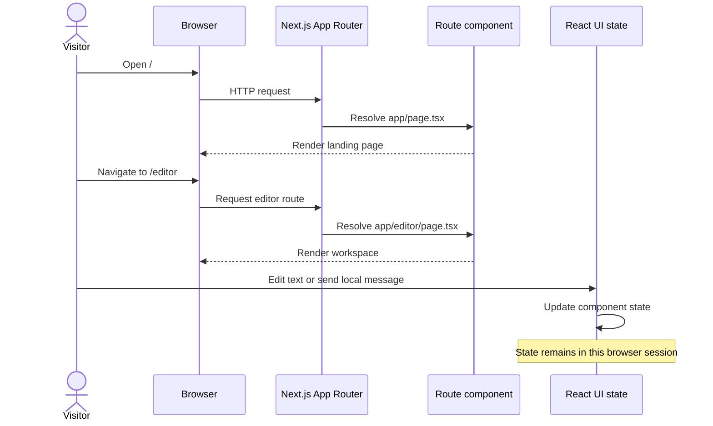

# 🔄 Application Lifecycle

## Request and rendering lifecycle

This illustrates the page and local state lifecycle, not server-side collaboration.

## Editor state lifecycle

1. The route mounts the editor component.
2. The editor initializes a sample source string and a default language label.
3. The loading timer ends and the editable area becomes visible.
4. An input event updates the component's code state.
5. A route reload remounts the component and restores the sample value.

## Chat state lifecycle

1. Chat panel mounts when opened.
2. The panel initializes sample messages.
3. A submitted team message is appended to local React state.
4. The AI Preview tab appends a user message and later a fixed response.
5. Unmounting or reloading discards the in-memory messages.

## No server lifecycle is implemented

There are no API request handlers, database transactions, authentication sessions, background workers, WebSocket connections, or server-side message processing in the active application.

## Lifecycle changes required for a connected product

A real system must define identity acquisition, workspace authorization, room join/leave, presence heartbeats, document synchronization, retries, reconnect, persistence, deletion, and service shutdown. Each transition needs a failure state and a test.
