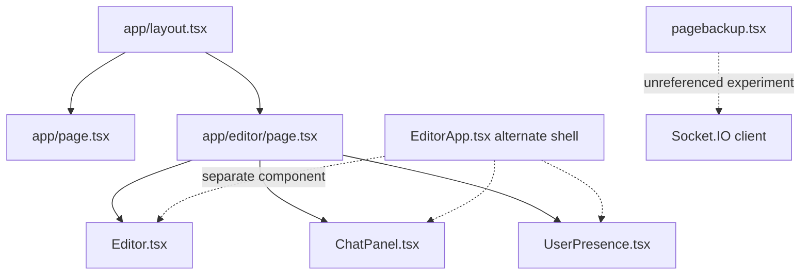

# 🏗️ CodeShare Architecture

## Architecture status

CodeShare is a Next.js App Router application with a landing page and a local editor/chat prototype. The routed app has no collaboration server, supported API route, database, AI provider, or persistence layer.

## Current route architecture

The active workspace route is app/editor/page.tsx. EditorApp.tsx is another component shell in the component directory, but it is not the route page imported by the App Router.

## Main components

| Component | Responsibility |
|---|---|
| app/layout.tsx | Root layout, Geist font setup, Mantine provider, metadata, global styles |
| app/page.tsx | CodeShare landing page, prototype disclosure, editor navigation |
| app/editor/page.tsx | Active editor route, theme state, chat-panel visibility, workspace header |
| app/components/Editor.tsx | Local sample text, editable preformatted area, language selection |
| app/components/ChatPanel.tsx | Local Team messages and fixed AI Preview response |
| app/components/UserPresence.tsx | Static sample profile list and external avatar requests |
| app/components/EditorApp.tsx | Alternate/duplicate workspace shell, not the active route import |
| pagebackup.tsx | Unreferenced Socket.IO experiment; no matching server exists |

## State and data flow

Editor text, selected language, dark mode, chat visibility, message lists, and active chat tab are held in React state in the current browser page. Reloading resets these values. The routed components do not establish a Socket.IO session and do not transmit editor or chat content to an application server.

## Network and third-party resources

- UserPresence references remote avatar images hosted by pravatar.cc.
- app/layout.tsx configures next/font/google for font assets.
- The browser also makes ordinary requests to the CodeShare host for application routes and static resources.

The external avatar and font dependencies are not CodeShare collaboration services. Their availability and privacy behavior are controlled by the external provider/hosting environment.

## Security boundary

There is no authentication, authorization, server-side room model, app API, database, or persistent storage. Do not use this prototype for confidential source code or private team messages under the assumption that access is protected.

Any future networked feature needs a reviewed threat model, server-side authorization, data-flow update, privacy notice, and integration tests before being described as functional.

## Proposed future architecture

The future collaboration diagram is a conceptual direction only. It must be reviewed for identity, room isolation, document synchronization, persistence, AI provider data flows, operations, and recovery before implementation.

See [component architecture](component-architecture.md), [project structure](project-structure.md), and [data flow](data-flow.md).
