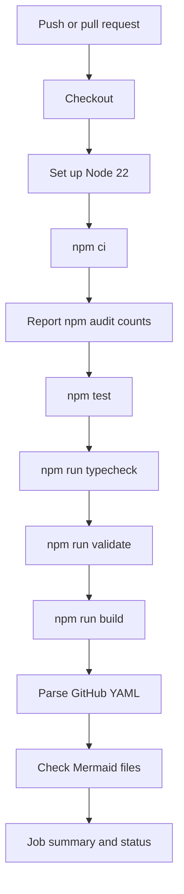

# ⚙️ CI/CD and Repository Automation

## Current workflows

| Workflow | Trigger | Responsibility |
|---|---|---|
| `quality-checks.yml` | Push, pull request, weekly schedule, manual dispatch | Install, audit-report, Node tests, type check, repo validate, Next build, YAML parse, Mermaid presence |
| `update-readme.yml` | Push, hourly schedule, manual dispatch | Update the README timestamp |

## Quality pipeline

The audit reporting step is informational. It records the number of advisories but does not remediate vulnerable dependencies or make the build fail based on the count. This is an explicit temporary limitation.

## Permissions and concurrency

The quality workflow uses read-only repository contents permission and a concurrency group that cancels superseded runs on the same ref. Workflows that publish security findings or update repository content need separate, minimal permissions and should not inherit broad write access.

## README timestamp workflow

The timestamp automation writes to the README after pushes and on a schedule. This creates additional commits and CI events. Keep its permissions restricted to content writes, and do not use it for application logic or release decisions.

## Required future automation

Potential additions include CodeQL for supported languages, dependency review on pull requests, and documentation-specific validation. They should use least-privilege tokens, review action versions, avoid untrusted PR code under write permissions, and report meaningful failures.

## Operational notes

A green workflow proves only that its configured steps completed. It does not establish browser usability, live collaboration, authentication, or WCAG conformance.
