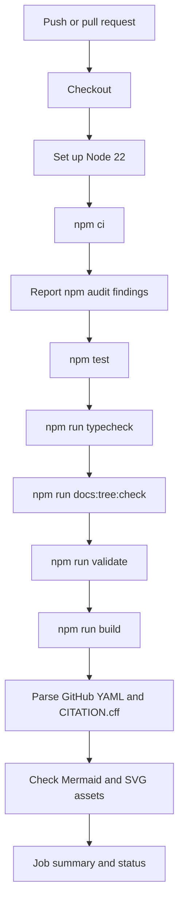

# ⚙️ CI/CD and Repository Automation

## Current workflows

| Workflow | Trigger | Responsibility |
|---|---|---|
| `quality-checks.yml` | Push, pull request, weekly schedule, manual dispatch | npm install, audit summary, Node tests, TypeScript check, generated-tree check, repository/link validation, Next.js build, YAML/CFF parse, Mermaid presence, SVG XML validation |
| `codeql.yml` | Push, pull request, weekly schedule, manual dispatch | CodeQL JavaScript/TypeScript static analysis |
| `dependency-review.yml` | Pull request, manual dispatch | Review dependency changes and fail on high-severity findings |
| `update-readme.yml` | Push excluding README changes, weekly schedule, manual dispatch | Update README timestamp with the GitHub Actions bot identity |

Dependabot separately proposes npm and GitHub Actions updates weekly.

## Quality pipeline

## Security reporting behavior

The npm audit reporting step records affected package names and severity counts, but remains informational. It does not update the lockfile or fail the general build based on advisory severity. This is a known limitation while the dependency remediation work remains open. CodeQL and dependency-review provide separate analysis paths, not a guarantee of dependency safety.

## Permissions and concurrency

The quality workflow uses read-only repository contents permission and a concurrency group that cancels superseded runs on the same ref. CodeQL receives the security-events permission needed to publish analysis results. Dependency review has pull-request write permission only because it posts a dependency summary comment. The README timestamp workflow has contents write permission for its single documented commit.

## Project-tree maintenance

The generator uses `git ls-files` to update the tracked-file tree. Run `npm run docs:tree` after path changes; CI runs `npm run docs:tree:check` so an outdated tree fails the quality job.

## README timestamp workflow

The timestamp automation runs after non-README pushes and weekly. It ignores README-only commits to avoid self-trigger loops and uses the GitHub Actions bot noreply identity. It is repository metadata automation, not a release or application process.

## Operational notes

A green workflow proves only that its configured steps completed. It does not establish browser usability, real-time collaboration, authentication, a secure hosting configuration, or WCAG conformance.
