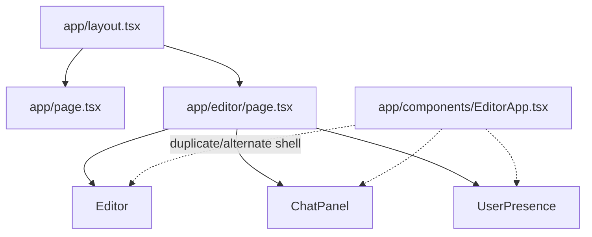

# 🧩 Component Architecture

## Current component map

The active route is `app/editor/page.tsx`. The `EditorApp.tsx` component is another editor shell in the source tree but is not the page route imported by `app/editor/page.tsx`.

## Responsibilities

| Component | Responsibility | State or data |
|---|---|---|
| Root layout | Global font, metadata, CSS, Mantine provider | No product state |
| Landing page | Introduces prototype and route navigation | Static content |
| Editor route | Header, local theme, drawer state, chat toggle, bottom labels | Local React state and disclosure hook |
| Editor | Sample source text and language selector | Local code and language state |
| ChatPanel | Team and AI preview tabs, message input, message list | Local team and AI message arrays |
| UserPresence | Sample profile avatars | Static array |
| EditorApp | Alternate workspace shell retained in component directory | Local workspace state |

## Reuse and ownership guidance

- Keep route-level composition in the App Router page.
- Keep component props explicit and narrow.
- Do not duplicate active routing logic without a documented reason.
- Keep network behavior out of UI components until a service boundary and contracts exist.
- Extract pure behavior into testable functions before adding non-trivial business logic.
- Treat all sample profiles and demo messages as fixtures, not real user data.

## State and event boundaries

The editor owns code text and selected language. The chat panel owns the two message lists and active tab. The route owns theme and chat visibility. There is no shared state store or cross-browser event bus.

## Future decomposition

If the product gains connected behavior, consider separate modules for identity, room state, document synchronization, messaging, presence, persistence, and AI proxy. Add these only when those features have an approved architecture and tests. Avoid creating empty folders that imply nonexistent services.
