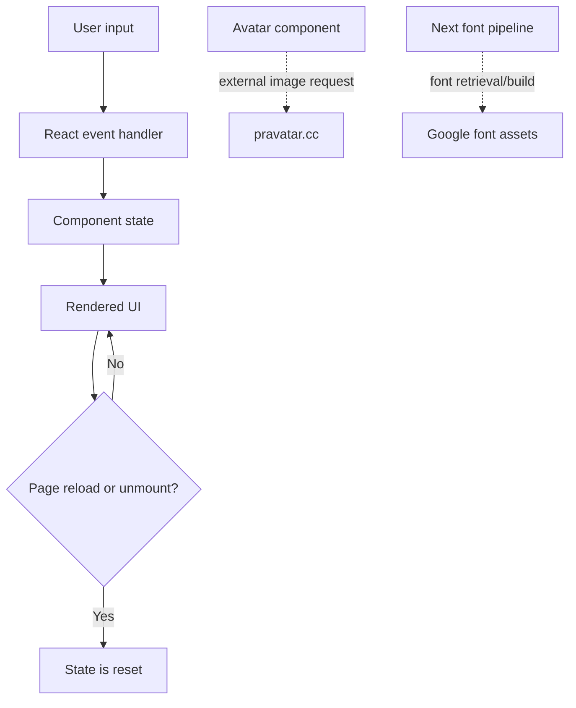

# 🔀 Data Flow

## Current data flow

The active workspace primarily uses local state. User input is handled by React components and rendered back into the current page.

## Data categories

| Data | Origin | Current processing | Persistence |
|---|---|---|---|
| Sample editor content | Component initial state | Browser edit events update local state | None |
| Team chat messages | Sample initial array and visitor input | React state and rendered list | None |
| AI preview | Visitor prompt and fixed response | Local message state | None |
| Presence | Static profile array | Avatar and label display | Static source only |
| Font/avatar assets | External providers | Browser/build asset requests | External provider behavior |

## No backend transfer for editor/chat

The routed editor and chat components do not connect to an app server to transmit changes. This means there is no cross-browser document or message flow. The browser may still make normal page and external asset requests.

## Data-flow changes require review

Adding APIs, WebSockets, authentication, storage, uploads, or AI providers changes the trust boundary. Update architecture, threat model, privacy, data retention, configuration, and tests together.
