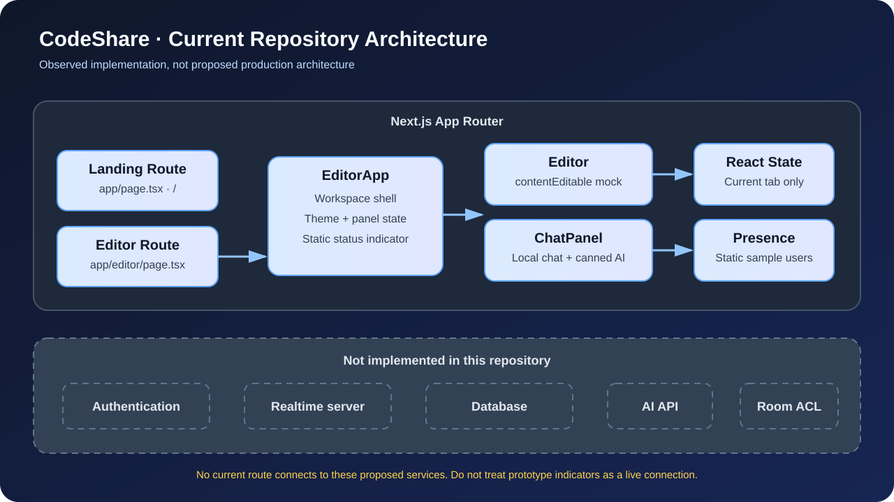

# 🗺️ Architecture Diagrams

These diagrams describe the current implementation and one explicitly proposed future design.

  

| Diagram | Meaning |
|---|---|
| [Current architecture](current-architecture.mmd) | Actual Next.js routes and UI components |
| [UI flow](ui-flow.mmd) | Current landing/editor/chat interactions |
| [Current data boundary](current-data-boundary.mmd) | Local-only state and no persistence |
| [Future collaboration architecture](future-collaboration.mmd) | Proposed production design, not implemented |
| [CI and release flow](ci-release-flow.mmd) | Quality and release gates |
| [Security boundaries](security-boundaries.mmd) | Current external requests and missing services |
