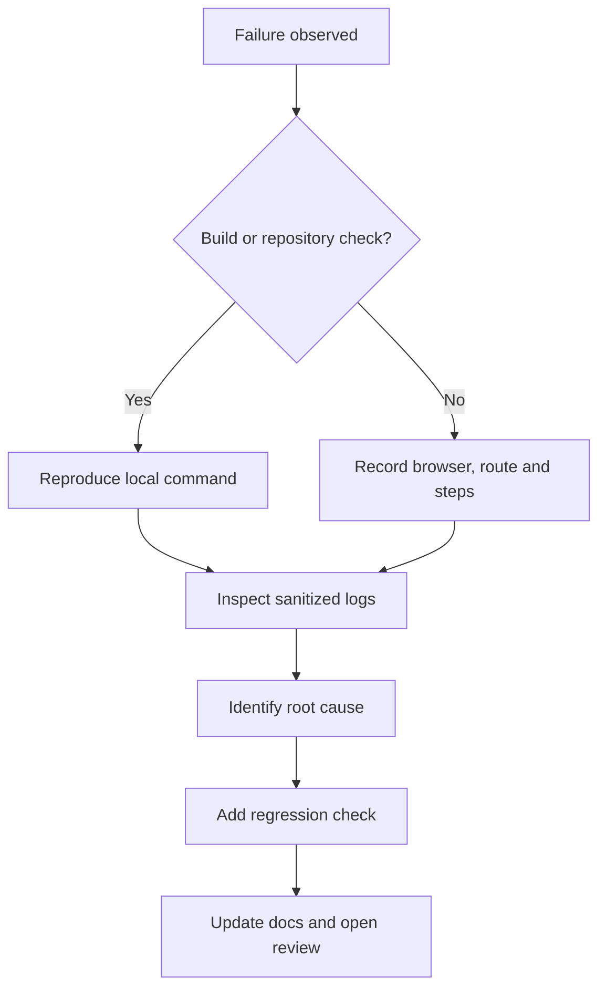

# 🚨 Error Handling

## Current error surface

The routed prototype has very limited application-side error handling because it does not make calls to application APIs or connect to collaboration services.

Current observable concerns include:
- the editor's simulated loading state is timer-based, not a network load;
- external avatars may fail to render;
- invalid or unavailable dependency versions can cause install/build failures;
- a future integration could fail due to network, authorization, rate limiting, or provider outages, but those paths are not implemented.

## Current contributor response

| Failure | Response |
|---|---|
| `npm ci` fails | Check Node/npm versions, lockfile integrity, and registry availability |
| Type check fails | Reproduce with `npm run typecheck`, inspect the first relevant compiler error |
| Validator fails | Correct the missing required file, package mismatch, or local Markdown link |
| Production build fails | Reproduce with `npm run build`; inspect Next.js diagnostics |
| Avatar does not load | Confirm it is an external sample asset and not an app service failure |
| UI interaction fails | Record route, browser, viewport, steps, expected and actual result |

## Future service error contract

If APIs are added, define typed error categories and stable response shapes. Do not expose stack traces, secrets, SQL errors, provider payloads, or internal identifiers to visitors. Validate user input at the boundary, distinguish authentication from authorization failures, and record only the minimum safe operational context.

## Error-handling flow

## Logging

Do not add personal data or source code to logs by default. A future server should define correlation IDs, redaction, retention, access restrictions, and incident review before operational logging is introduced.
