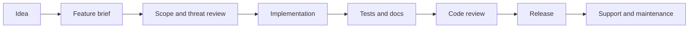

# ✨ Feature Inventory

This document describes features as they exist in the checked-in source. A visible control is not evidence that the connected service behind it exists.

## Implemented interface behavior

| Feature | Source | Behavior |
|---|---|---|
| Landing page | `app/page.tsx` | Introduces the prototype and links to the editor |
| Editor route | `app/editor/page.tsx` | Renders the local workspace |
| Text editing | `app/components/Editor.tsx` | Lets a visitor edit a local text string with `contentEditable` |
| Language selector | `Editor.tsx` | Changes the selected language label only |
| Theme toggle | `app/editor/page.tsx` | Switches local light/dark styling |
| Chat panel | `app/components/ChatPanel.tsx` | Opens a local team/AI preview panel |
| Team chat | `ChatPanel.tsx` | Displays example messages and holds new messages in React state |
| AI preview | `ChatPanel.tsx` | Returns a fixed demonstration response |
| Sample presence | `app/components/UserPresence.tsx` | Displays three static sample profiles |

## Not implemented

| Product feature | Missing system capability |
|---|---|
| Shared real-time editing | No synchronization server or protocol |
| Persistent documents | No database or storage API |
| Multi-user team chat | No message transport or server |
| AI code assistant | No model provider or server-side proxy |
| Authenticated accounts | No identity/session system |
| Private rooms | No server-side room authorization |
| Voice chat | No permission flow, audio transport, or signaling |
| Audit history | No event store or audit pipeline |
| Recovery | No backup or restore mechanism |

## Interaction details

The language selector controls display state and does not parse or validate code. The editor is a simple editable preformatted area and is not a substitute for a full IDE. Chat messages are in-memory only and disappear when the page is reloaded. The AI preview response is static.

## Feature acceptance rule

A feature may be described as implemented only when there is an actual end-to-end behavior in the repository, a repeatable way to exercise it, and a test or documented manual verification path. UI mockups, hard-coded status indicators, comments, and roadmap items do not meet that standard.

## Feature lifecycle

Use [feature brief template](templates/feature-brief.md) for proposed work.
