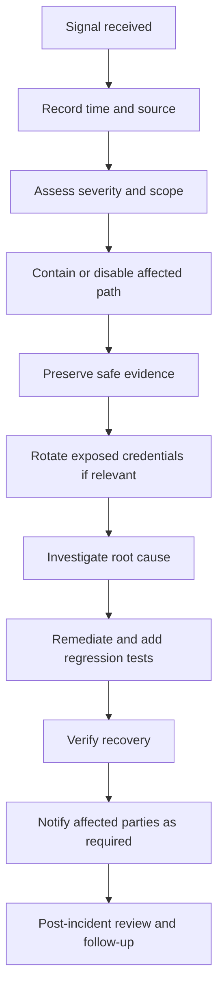

# 🚨 Incident Response

## Current readiness

The repository has no production service, backend, database, or formal on-call rotation configured. This runbook defines a baseline process for a future deployment and for repository credential exposure. It does not claim that a staffed incident response function exists.

## Severity guide

| Severity | Example | Initial response |
|---|---|---|
| Critical | Confirmed private data disclosure, remote compromise, exposed production credential | Contain immediately; notify repository owner and relevant provider |
| High | Exploitable vulnerability in deployed service or broad service outage | Prioritize containment and impact assessment |
| Medium | Limited defect with a safe workaround | Triage, assign owner, track remediation |
| Low | Cosmetic or low-impact documentation issue | Schedule normal maintenance |

## Response lifecycle

## Credential exposure procedure

1. Revoke or rotate the affected credential immediately with its provider.
2. Determine permissions and systems reachable by the credential.
3. Inspect relevant provider logs where available.
4. Remove the secret from active files and address Git history through a reviewed process.
5. Add or improve secret scanning and regression checks.
6. Record the incident without copying the secret value into issues or reports.

## Communications and evidence

Use private reporting for sensitive details. Preserve timestamps, affected revisions, system identifiers, and sanitized logs. Do not publish exploit details while affected systems remain vulnerable.

## Recovery and closure

Confirm the affected component is restored, credentials are rotated, required users are informed, and regression checks exist. Assign owners and dates for all post-incident actions.

## Related documents

See [SECURITY.md](../SECURITY.md), [secret exposure runbook](runbooks/secret-exposure.md), and [incident report template](templates/incident-report.md).
