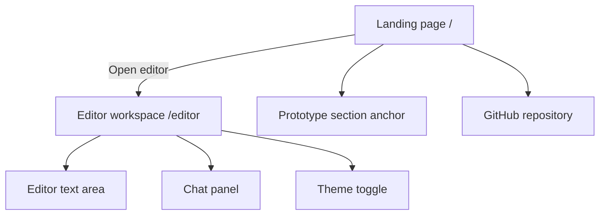

# 🧭 Navigation Structure

## Current routes

| Path | Source | Purpose |
|---|---|---|
| `/` | `app/page.tsx` | Landing and prototype explanation |
| `/editor` | `app/editor/page.tsx` | Local editor workspace |

There are no nested project, room, account, settings, or API routes in the current App Router tree.

## Current navigation map

## Link behavior

Use Next.js `Link` for internal route navigation and standard anchors for external destinations and same-page anchors. External links opened in a new tab should use an appropriate `rel` attribute.

## Future navigation decisions

If accounts, rooms, and saved projects are implemented, define route ownership, authorization requirements, deep-link behavior, redirects, unknown-route behavior, and keyboard navigation before adding routes. Avoid exposing private project identifiers in URLs unless the security model explicitly accounts for them.
