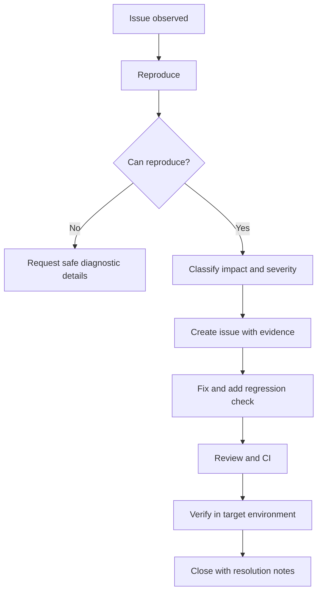

# ✅ Quality Assurance Guide

## QA scope

CodeShare currently has two routes and a small local component state model. QA should verify the actual prototype behavior and the repository's build pipeline. It should not attempt to validate absent services as though they are implemented.

## QA layers

| Layer | Current approach | Coverage boundary |
|---|---|---|
| Static contract checks | Node built-in tests | Package, routes, labels, prototype disclaimers |
| Type check | TypeScript compiler | Compile-time types only |
| Repository validation | Custom Node script | Required files, manifest/lock metadata, npm scripts, local Markdown links |
| Production build | Next.js build | Compilation and prerendering |
| YAML validation | PyYAML in CI | GitHub metadata syntax |
| Mermaid presence | CI file check | Non-empty files, not complete diagram semantic validation |
| Browser smoke tests | Manual checklist | Human-run interactions |
| Security tests | Dependency audit reporting and planned static analysis | No auth/backend integration exists |
| Accessibility | Manual audit plan | No completed audit result |

## Bug severity guidance

- **Critical:** exposed secret, unauthorized sensitive access, or a blocker that compromises user data.
- **High:** major route or core interaction unavailable, serious dependency vulnerability, or broad user impact.
- **Medium:** important UI or workflow defect with a workaround.
- **Low:** cosmetic or minor documentation issue.

Severity should be justified with impact and reproducibility. A high-severity finding is not automatically a security vulnerability.

## Defect lifecycle

## Evidence standards

Include browser/OS versions, viewport, route, exact steps, expected result, actual result, sanitized console output, and a screenshot only if captured from a real application run. Never add credentials, private source code, or personal data to public issue content.

## Release gate

Do not call a release ready if mandatory CI fails, critical/high dependency risks are unexplained, release notes are absent, or known limitations are hidden from users.
