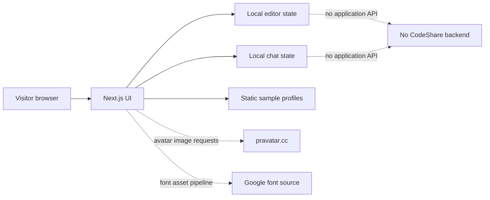

# 🛡️ Security Architecture

## Current architecture

The current CodeShare runtime is a browser-facing Next.js application with two routes. The editor and chat operate on local React state. No authentication provider, session service, API handler, database, collaboration server, private room, or server-side document store is present.

The current architecture therefore has no CodeShare server trust boundary protecting user content.

| Security layer | Current status | Practical implication |
|---|---|---|
| Identity | Not implemented | Visitors are not authenticated users |
| Authentication | Not implemented | No verified session exists |
| Authorization | Not implemented | No protected resource or role check exists |
| Network API | Not implemented | No application API to authorize |
| Real-time transport | Not implemented on routed screens | No shared document or chat traffic |
| Persistence | Not implemented | No saved workspace record |
| Secrets | No application environment variables currently required | No server-side provider secret is configured |
| External resources | Avatar and font assets are requested from external providers | Third-party request and availability considerations remain |

## Current security boundary diagram

## Future architecture requirements

Any connected collaboration design must explicitly include:

1. Verified identity and a secure session lifecycle.
2. Server-side authorization for every workspace, document, message, export, and administrative operation.
3. Secure transport and strict origin validation for real-time connections.
4. Input validation, payload limits, rate limits, anti-abuse controls, and safe error handling.
5. Secrets that remain on the server and are rotated through an approved process.
6. A data classification, retention, export, deletion, and backup policy.
7. Security event handling, monitoring, incident ownership, and recovery tests.
8. Automated negative tests proving that users cannot cross room or project boundaries.

## Secure design rule

A visual indicator, hidden button, client-side route guard, or untrusted room ID is not an authorization control. The server must verify the authenticated actor's permissions against the target resource on every operation.

## Review triggers

Update this document whenever authentication, an API, WebSocket transport, persistence, file uploads, an AI provider, or hosting infrastructure is added. Link the change to a threat assessment and security/privacy review.
