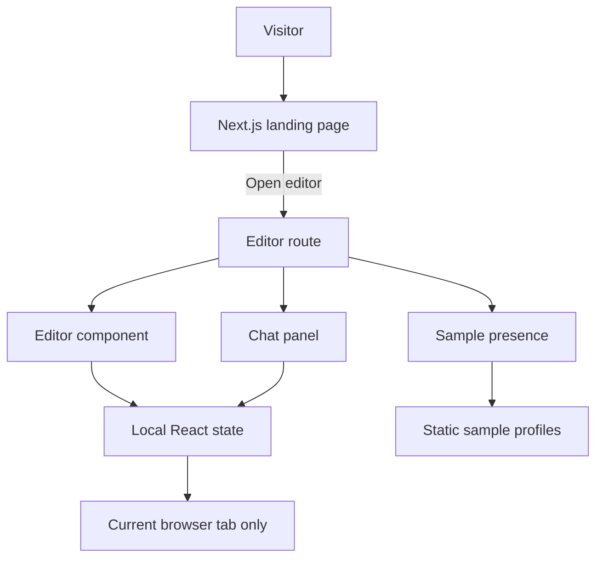

# 🛠️ Solution Overview

## Present solution: a local interface prototype

CodeShare currently provides a browser UI that lets a visitor inspect the proposed workspace concept. The Next.js App Router serves a landing page and an editor page. React component state controls local editor text, selected language label, chat messages, theme, and panel visibility.

The diagram describes the current implementation. It contains no API, database, websocket, identity provider, or AI model service.

## Why this solution is intentionally local

Keeping the prototype local avoids suggesting that shared editing or private rooms are available. It allows the interface and core navigation to be explored without creating a false assumption that users' source code is transmitted securely.

## Future production architecture, subject to approval

A real service might include authenticated users, server-authorized rooms, a document synchronization service, durable storage, chat delivery, an AI provider proxy, and monitoring. The existing [future collaboration diagram](diagrams/future-collaboration.mmd) is a conceptual proposal only. It must not be interpreted as a description of deployed components.

## Architectural decisions still required

| Decision | Why it matters | Required evidence |
|---|---|---|
| Editor engine | Editing model, accessibility, language support, and collaboration integration | Prototype comparison and dependency review |
| Identity | Account lifecycle and recovery | Threat model and identity requirements |
| Room authorization | Prevent cross-room access | Authorization matrix and negative tests |
| Document sync | Concurrent edits, ordering, reconnect, conflict resolution | Protocol design and integration tests |
| Persistence | Saved work, backup, retention, deletion | Data classification and lifecycle policy |
| AI provider | Data transfer, retention, consent, cost | Provider review, proxy design, privacy review |
| Deployment | Secrets, regions, scaling, recovery, observability | Operational architecture and cost estimate |

## Boundaries

The current app is not production-ready for confidential code or private team discussion. Any change that introduces network transmission or persistence must update the security, privacy, configuration, architecture, and test documentation before release.
