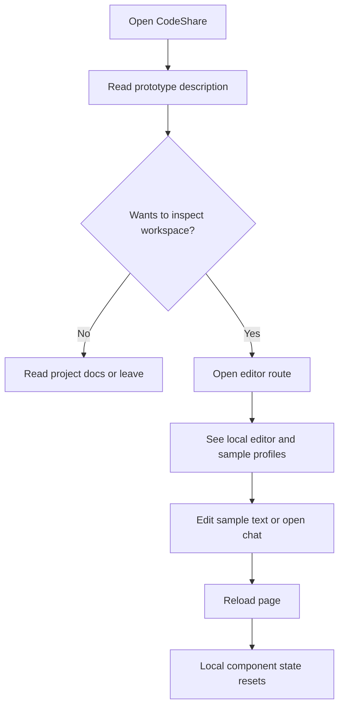

# 🧭 User Journeys

## Journey 1: Explore the prototype

The final reset step is intentional prototype behavior. There is no server save operation or shared workspace.

## Journey 2: Send a sample team message

1. Open `/editor`.
2. Open the chat panel.
3. Select the Team tab.
4. Enter a non-empty message and submit.
5. Confirm the message appears in the local message list.
6. Reload the route and observe that the local state is lost.

This is not a cross-browser delivery test. It checks only local UI behavior.

## Journey 3: Try the AI preview

1. Open the workspace and chat panel.
2. Select AI Preview.
3. Enter a short prompt.
4. Observe the fixed response.
5. Confirm that no model provider, server call, or external inference is claimed.

## Future journey: secure multi-user room

A future user journey could include authentication, room creation, invitation, role checks, document editing, chat, reconnection, export, and deletion. It must not be merged with the current prototype journey until those services are implemented and tested.

## Journey review checklist

For each new flow, document:
- entry point and preconditions;
- user goal and expected outcome;
- empty, loading, error, and retry states;
- keyboard and screen-reader path;
- authorization decision points;
- data collected and where it flows;
- cancellation, leave, export, and deletion behavior;
- observable test evidence.
